# The Skool Instruction Manual 
How to analyze statistics and report results to determine future business datadriven decisions 

## Step 1: Create a SQL script that will load the data you want to analyze and name it properly
Open the terminal and run the following command:

``` 
nano <load_your_file_title>.sql
```

## Step 2: Import the data you want to analyze in your Oracle26ai Linux VM from either an excel-file or csv-file
Inside your nano file, type the following code:

```
SET LOAD SCAN_ROWS 1200
LOAD results_col3 <your_table_title> results_col3.csv <your_file_title_and_extention> NEW

EXIT
```

## Step 3: Create a new SQL script for each statistics column you want to analyze
For instance, if you want to view the amount of applications per educationarea, sorted by most applications, type the following code inside a SQL script:
 
```
SET PAGESIZE 1500
DESC system.results_col3;

SELECT UTBILDNINGSOMRADE AS educationarea,
        SUM(SOKTA_PLATSER_TOTALT) AS applications
FROM results_col3
GROUP BY UTBILDNINGSOMRADE
ORDER BY applications DESC;

EXIT
```

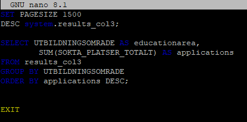

If you want to view the amount of approved applications per educationarea, type the following code inside another SQL script:

```
SET PAGESIZE 1500
DESC system.results_col3;

SELECT UTBILDNINGSOMRADE AS educationarea,
        SUM(BEVILJADE_PLATSER_TOTALT) AS approved_applications
FROM results_col3
GROUP BY UTBILDNINGSOMRADE
ORDER BY approved_applications DESC;

EXIT
```

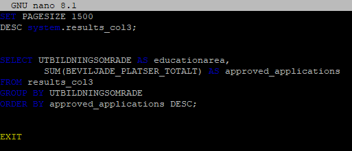


If you want to view the amount of rejected applications per educationarea, type the following code inside another SQL script:

```
SET PAGESIZE 1500
DESC system.results_col3;

SELECT UTBILDNINGSOMRADE AS educationarea,
        (SUM(SOKTA_PLATSER_TOTALT)) -
        (SUM(BEVILJADE_PLATSER_UTBILDNINGSO) +
        SUM(BEVILJADE_PLATSER_UTBILDNINGS2) +
        SUM(BEVILJADE_PLATSER_UTBILDNINGS3) +
        SUM(BEVILJADE_PLATSER_UTBILDNINGS4) +
        SUM(BEVILJADE_PLATSER_UTBILDNINGS5)) AS rejected_applications
FROM results_col3
GROUP BY UTBILDNINGSOMRADE
ORDER BY rejected_applications DESC;

EXIT
```

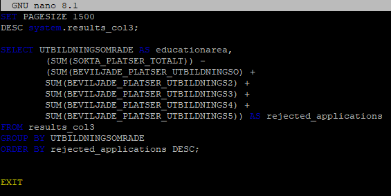


If you want to view the amount of approved applications per educationtitle within DATA/IT, type the following code inside another SQL script:

```
SET PAGESIZE 1500
DESC system.results_col3;

SELECT
	UTBILDNINGSNAMN AS title,
       SUM(BEVILJADE_PLATSER_UTBILDNINGSO) +
       SUM(BEVILJADE_PLATSER_UTBILDNINGS2) +
       SUM(BEVILJADE_PLATSER_UTBILDNINGS3) +
       SUM(BEVILJADE_PLATSER_UTBILDNINGS4) +
       SUM(BEVILJADE_PLATSER_UTBILDNINGS5) AS approved_applications
FROM results_col3
WHERE UTBILDNINGSOMRADE = 'Data/IT'
	AND UTBILDNINGSNAMN LIKE '%Data%'
   	OR UTBILDNINGSNAMN LIKE '%IT%'
GROUP BY UTBILDNINGSOMRADE, UTBILDNINGSNAMN
HAVING SUM(BEVILJADE_PLATSER_UTBILDNINGSO) +
       SUM(BEVILJADE_PLATSER_UTBILDNINGS2) +
       SUM(BEVILJADE_PLATSER_UTBILDNINGS3) +
       SUM(BEVILJADE_PLATSER_UTBILDNINGS4) +
       SUM(BEVILJADE_PLATSER_UTBILDNINGS5) > 0
ORDER BY approved_applications DESC, UTBILDNINGSNAMN DESC;

EXIT
```

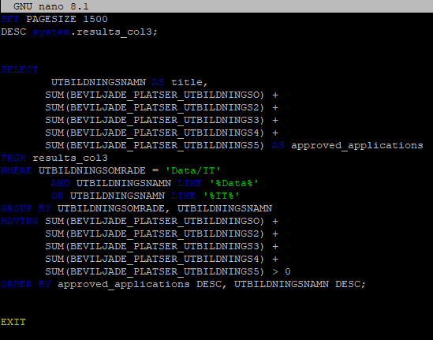


If you want to view the amount of rejected applications per educationtitle within DATA/IT, type the following code inside another SQL script:

```
SET PAGESIZE 1500
DESC system.results_col3;

SELECT
	UTBILDNINGSNAMN AS title,
	(SUM(SOKTA_PLATSER_TOTALT)) -
       SUM(BEVILJADE_PLATSER_UTBILDNINGSO) +
       SUM(BEVILJADE_PLATSER_UTBILDNINGS2) +
       SUM(BEVILJADE_PLATSER_UTBILDNINGS3) +
       SUM(BEVILJADE_PLATSER_UTBILDNINGS4) +
       SUM(BEVILJADE_PLATSER_UTBILDNINGS5) AS rejected_applications
FROM results_col3
WHERE UTBILDNINGSOMRADE = 'Data/IT'
	AND UTBILDNINGSNAMN LIKE '%Data%'
   	OR UTBILDNINGSNAMN LIKE '%IT%'
GROUP BY UTBILDNINGSNAMN
ORDER BY rejected_applications DESC, UTBILDNINGSNAMN DESC;

EXIT
```

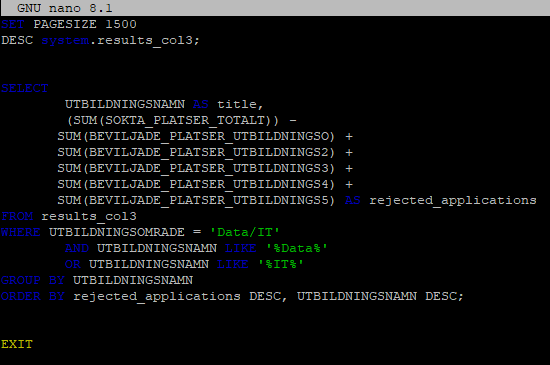


If you want to view the amount of approved applications per school and education within DATA/IT, type the following code inside another SQL script:

```
SET PAGESIZE 1500
DESC system.results_col3;

SELECT UTBILDNINGSANORDNARE_ADMINISTR AS education_provider,
	UTBILDNINGSNAMN AS education,
        SUM(BEVILJADE_PLATSER_UTBILDNINGSO) +
        SUM(BEVILJADE_PLATSER_UTBILDNINGS2) +
        SUM(BEVILJADE_PLATSER_UTBILDNINGS3) +
        SUM(BEVILJADE_PLATSER_UTBILDNINGS4) +
        SUM(BEVILJADE_PLATSER_UTBILDNINGS5) AS approved_applications
FROM results_col3
WHERE UTBILDNINGSOMRADE = 'Data/IT'
	AND UTBILDNINGSNAMN LIKE '%Data%'
   	OR UTBILDNINGSNAMN LIKE '%IT%'
GROUP BY UTBILDNINGSANORDNARE_ADMINISTR, UTBILDNINGSNAMN
HAVING SUM(BEVILJADE_PLATSER_UTBILDNINGSO) +
       SUM(BEVILJADE_PLATSER_UTBILDNINGS2) +
       SUM(BEVILJADE_PLATSER_UTBILDNINGS3) +
       SUM(BEVILJADE_PLATSER_UTBILDNINGS4) +
       SUM(BEVILJADE_PLATSER_UTBILDNINGS5) > 0
ORDER BY approved_applications DESC;

EXIT
```

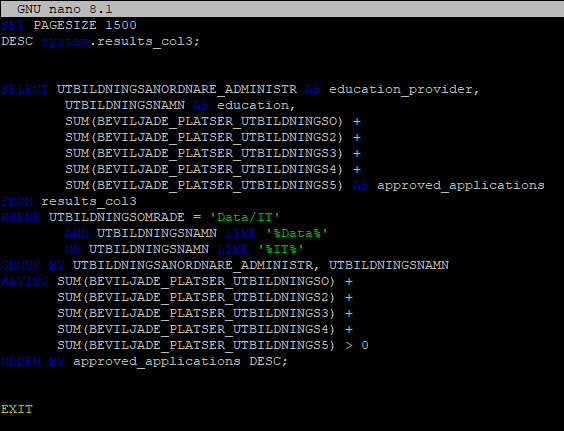


If you want to view the most amount of approved applications per county and sort by top 5 counties, type the following code inside another SQL script:

```
SET PAGESIZE 1500
DESC system.results_col3;

SELECT LAN AS county,
        SUM(BEVILJADE_PLATSER_UTBILDNINGSO) +
        SUM(BEVILJADE_PLATSER_UTBILDNINGS2) +
        SUM(BEVILJADE_PLATSER_UTBILDNINGS3) +
        SUM(BEVILJADE_PLATSER_UTBILDNINGS4) +
        SUM(BEVILJADE_PLATSER_UTBILDNINGS5) AS approved_applications
FROM results_col3
WHERE LAN <> 'Flera kommuner' 
GROUP BY LAN
ORDER BY approved_applications DESC
FETCH FIRST 5 ROWS ONLY;

EXIT
```

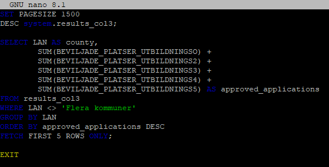


If you want to view the percentages of remote and on-campus programs within each educationsarea, type the following code inside another SQL script:

```
SET PAGESIZE 1500
DESC system.results_col3;

SELECT
    r1.utbildningsomrade AS educationarea,
    SUM(CASE
        WHEN r1.STUDIEFORM = 'Bunden'
        THEN r1.Sokta_platser_totalt
        ELSE 0
    END) AS campus_applications,
    SUM(CASE
        WHEN r1.STUDIEFORM = 'Distans'
        THEN r1.Sokta_platser_totalt
        ELSE 0
    END) AS remote_applications,
    ROUND(
        100 * SUM(CASE WHEN r1.STUDIEFORM = 'Bunden'
            THEN r1.Sokta_platser_totalt ELSE 0 END)
        / NULLIF(SUM(r1.Sokta_platser_totalt), 0), 2
    ) || '%' AS campus_applications_percentages,
    ROUND(
        100 * SUM(CASE WHEN r1.STUDIEFORM = 'Distans'
            THEN r1.Sokta_platser_totalt ELSE 0 END)
        / NULLIF(SUM(r1.Sokta_platser_totalt), 0), 2
    ) || '%' AS remote_applications_percentages,
    SUM(r1.Sokta_platser_totalt) AS total_applications
FROM results_col3 r1
GROUP BY
    r1.utbildningsomrade
ORDER BY
    r1.utbildningsomrade DESC;

EXIT
```

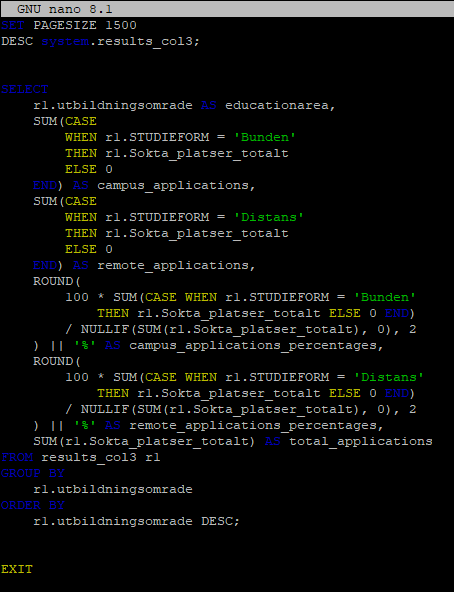


If you want to view the amount of educations including the word "AI", type the following code inside another SQL script:

```
SET PAGESIZE 1500
DESC system.results_col3;

SELECT UTBILDNINGSNAMN AS education_title
	FROM results_col3
WHERE (UTBILDNINGSNAMN LIKE '%AI%'
	OR UTBILDNINGSNAMN LIKE '%ai%');


SELECT
	COUNT(*) AS amount_of_educations_including_AI
	FROM results_col3
WHERE (UTBILDNINGSNAMN LIKE '%AI%'
	OR UTBILDNINGSNAMN LIKE '%ai%');

EXIT
```

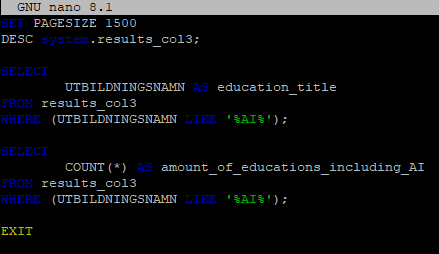


## Step 4: Alternatively, create one SQL script where you can see several statistics columns simultaneously by joining multiple tables
For instance, if you want to view the educationarea, specialization, education, studyform, applied rounds, approved rounds, applied spots, approved spots, education_provider, municipality, county, reference id, SEQF level, and if it's a narrow occupation, sorted by most approved applications and approved rounds within DATA/IT, type the following code inside a SQL script:

```
SELECT 
	c.UTBILDNINGSOMRADE AS educationarea,
	b.SUN5_INRIKTNING_NAMN AS specialization,
	a.UTBILDNINGSNAMN AS education,
	a.STUDIEFORM AS studyform,
	a.SOKTA_OMGANGAR AS applied_rounds,
	a.BEVILJADE_OMGANGAR AS approved_rounds,
	a.SOKTA_PLATSER_TOTALT AS applied_spots,
	a.BEVILJADE_PLATSER_TOTALT AS approved_spots,
	e.ANORDNARE AS education_provider,
 	g.KOMMUN AS municipality,
	h.LAN AS county, 
	f.DIARIENUMMER AS reference_id,
	d.SEQF,
	a.SMALT_YRKE AS narrow_occupation		
FROM ANSOKAN a
	JOIN SUN5_INRIKTNING b ON b.SUN5_ID = a.SUN5_ID
	JOIN UTBILDNINGSOMRADE c ON c.UTBILDNINGSOMRADE_ID = b.UTBILDNINGSOMRADE_ID
	JOIN SEQF d ON d.SEQF_ID = a.SEQF_ID
	JOIN ANORDNARE e ON e.ANORDNARE_ID = a.ANORDNARE_ID
	JOIN ANSOKAN_KOMMUN f ON f.ANSOKAN_KOMMUN_ID = a.ANSOKAN_KOMMUN_ID
	JOIN KOMMUN g ON g.KOMMUN_ID = f.KOMMUN_ID
	JOIN LAN h ON h.LAN_ID = g.LAN_ID
WHERE c.UTBILDNINGSOMRADE = 'Data/IT'
	AND a.UTBILDNINGSNAMN LIKE '%Data%'
   	OR a.UTBILDNINGSNAMN LIKE '%IT%'
GROUP BY c.UTBILDNINGSOMRADE,
	b.SUN5_INRIKTNING_NAMN,
	a.UTBILDNINGSNAMN,
	a.STUDIEFORM,
	a.SOKTA_OMGANGAR,
	a.BEVILJADE_OMGANGAR,
	a.SOKTA_PLATSER_TOTALT,
	a.BEVILJADE_PLATSER_TOTALT,
	e.ANORDNARE,
	g.KOMMUN,
	h.LAN,
	f.DIARIENUMMER,
	d.SEQF,
	a.SMALT_YRKE
HAVING (SUM(a.BEVILJADE_PLATSER_TOTALT)) > 0
ORDER BY a.BEVILJADE_OMGANGAR DESC, a.BEVILJADE_PLATSER_TOTALT DESC;

EXIT
```

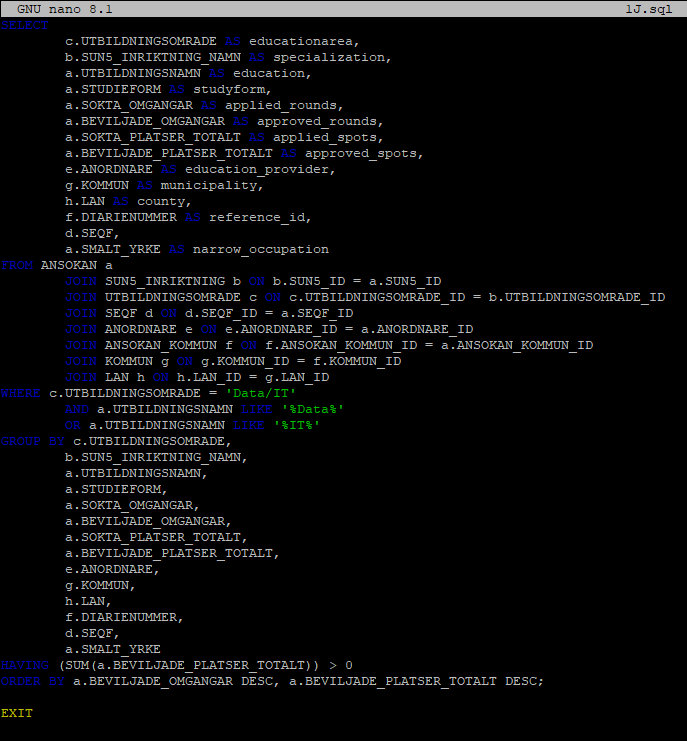


## Step 5: View the results of your SQL scripts and start analyzing the data
Open the terminal and run the following command:

``` 
orac <your_sql_script_title>.sql
```

For instance, if you want to view the most approved educationsareas, sorted by the highest applications rate, type the following code inside a SQL script:

```
SET PAGESIZE 1500
DESC system.results_col3;

SELECT
	UTBILDNINGSOMRADE AS educationarea,
	COUNT(*) AS total_applications,
	SUM(CASE WHEN Beslut = 'Beviljad'
		THEN 1 ELSE 0 END) AS approved_applications,
	SUM(CASE WHEN Beslut = 'Avslag'
		THEN 1 ELSE 0 END) AS rejected_applications,
	ROUND(
	100 * SUM(CASE WHEN Beslut = 'Beviljad'
		THEN 1 ELSE 0 END) / COUNT(*), 2
	) || '%' AS approvals_in_percentages
FROM results_col3
GROUP BY UTBILDNINGSOMRADE
ORDER BY approvals_in_percentages DESC;

EXIT
```

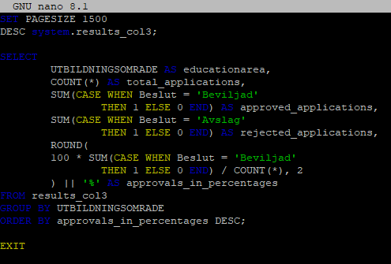


Press CTRL + O to save your sql script, and then press CTRL + X to close your sql script. In the terminal run the following command:

``` 
orac <3A_most_approved_educationareas>.sql
```

Press enter, the result should look like this:

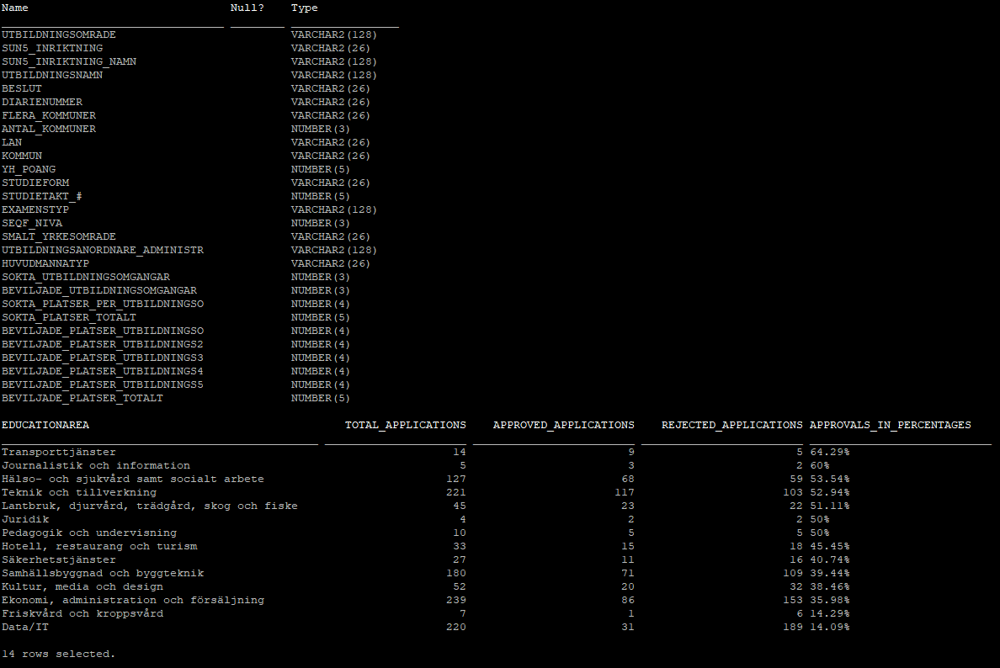


### Additional useful sql scripts

If you want to view the most approved SUN5 specializations within transportationservices, sorted by the highest applications rate, type the following code inside a SQL script:

```
SET PAGESIZE 1500
DESC system.results_col3;

SELECT
	SUN5_INRIKTNING AS SUN5_code,
	SUN5_INRIKTNING_NAMN AS SUN5_specialization,
	COUNT(*) AS applications,
	SUM(CASE WHEN Beslut = 'Beviljad'
		THEN 1 ELSE 0 END) AS approved,
	SUM(CASE WHEN Beslut = 'Avslag'
		THEN 1 ELSE 0 END) AS rejected,
	ROUND(
	100 * SUM(CASE WHEN Beslut = 'Beviljad'
		THEN 1 ELSE 0 END) / COUNT(*), 2
	) || '%' AS approvals_in_percentages 
FROM results_col3
WHERE (UTBILDNINGSOMRADE LIKE '%Transporttj_nster%')
GROUP BY
	SUN5_INRIKTNING,
	SUN5_INRIKTNING_NAMN
ORDER BY (ROUND(
	100 * SUM(CASE WHEN Beslut = 'Beviljad'
		THEN 1 ELSE 0 END) / COUNT(*), 2
	)) DESC;

EXIT
```

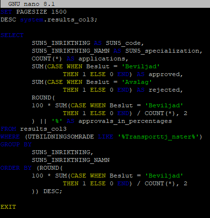


If you want to view the most approved educations within transportationservices, sorted by most approved rounds and the highest applications rate, type the following code inside a SQL script:

```
SET PAGESIZE 1500
DESC system.results_col3;

SELECT
	DIARIENUMMER AS reference_id,
	UTBILDNINGSNAMN AS education,
	SMALT_YRKESOMRADE AS narrow_occupation,
	STUDIEFORM AS studyform,
	UTBILDNINGSANORDNARE_ADMINISTR AS education_provider,
	HUVUDMANNATYP AS type,
	KOMMUN AS municipality,
	BEVILJADE_UTBILDNINGSOMGANGAR AS approved_rounds,
	COUNT(*) AS applications,
	SUM(CASE WHEN Beslut = 'Beviljad'
		THEN 1 ELSE 0 END) AS approved,
	SUM(CASE WHEN Beslut = 'Avslag'
		THEN 1 ELSE 0 END) AS rejected,
	ROUND(
	100 * SUM(CASE WHEN Beslut = 'Beviljad'
		THEN 1 ELSE 0 END) / COUNT(*), 2
	) || '%' AS approvals_percentages
FROM results_col3
WHERE (SUN5_INRIKTNING = '840aa'
	OR SUN5_INRIKTNING LIKE '%840cy%')
GROUP BY
	DIARIENUMMER,
	UTBILDNINGSNAMN,
	SMALT_YRKESOMRADE,
	STUDIEFORM,
	UTBILDNINGSANORDNARE_ADMINISTR,
	HUVUDMANNATYP,
	KOMMUN,
	BEVILJADE_UTBILDNINGSOMGANGAR
ORDER BY approved_rounds DESC, approvals_percentages DESC;

EXIT
```


If you want to view the most approved SUN5 specializations within DATA/IT, sorted by the highest applications rate, type the following code inside a SQL script:

```
SET PAGESIZE 1500
DESC system.results_col3;

SELECT
	SUN5_INRIKTNING AS SUN5_code,
	SUN5_INRIKTNING_NAMN AS SUN5_specialization,
	COUNT(*) AS applications,
	SUM(CASE WHEN Beslut = 'Beviljad'
		THEN 1 ELSE 0 END) AS approved,
	SUM(CASE WHEN Beslut = 'Avslag'
		THEN 1 ELSE 0 END) AS rejected,
	ROUND(
	100 * SUM(CASE WHEN Beslut = 'Beviljad'
		THEN 1 ELSE 0 END) / COUNT(*), 2
	) || '%' AS approvals_in_percentages
FROM results_col3
WHERE utbildningsomrade = 'Data/IT'
	AND Beslut IN ('Beviljad', 'Avslag')
GROUP BY
	SUN5_INRIKTNING,
	SUN5_INRIKTNING_NAMN
ORDER BY (ROUND(
	100 * SUM(CASE WHEN Beslut = 'Beviljad'
		THEN 1 ELSE 0 END) / COUNT(*), 2
	)) DESC;

EXIT
```

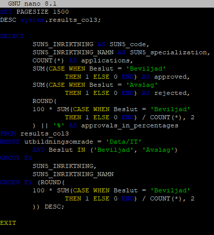


If you want to view the most approved educations within DATA/IT, sorted by most approved rounds and the highest applications rate, type the following code inside a SQL script:

```
SET PAGESIZE 1500
DESC system.results_col3;

SELECT
	DIARIENUMMER AS reference_id,
	UTBILDNINGSNAMN AS education,
	SMALT_YRKESOMRADE AS narrow_occupation,
	STUDIEFORM AS studyform,
	UTBILDNINGSANORDNARE_ADMINISTR AS education_provider,
	HUVUDMANNATYP AS type,
	KOMMUN AS municipality,
	BEVILJADE_UTBILDNINGSOMGANGAR AS approved_rounds,
	COUNT(*) AS applications,
	SUM(CASE WHEN Beslut = 'Beviljad'
		THEN 1 ELSE 0 END) AS approved,
	SUM(CASE WHEN Beslut = 'Avslag'
		THEN 1 ELSE 0 END) AS rejected,
	ROUND(
	100 * SUM(CASE WHEN Beslut = 'Beviljad'
		THEN 1 ELSE 0 END) / COUNT(*), 2
	) || '%' AS approvals_percentages
FROM results_col3
WHERE (SUN5_INRIKTNING = '481ae'
	OR SUN5_INRIKTNING LIKE '%481ab%')
GROUP BY
	DIARIENUMMER,
	UTBILDNINGSNAMN,
	SMALT_YRKESOMRADE,
	STUDIEFORM,
	UTBILDNINGSANORDNARE_ADMINISTR,
	HUVUDMANNATYP,
	KOMMUN,
	BEVILJADE_UTBILDNINGSOMGANGAR
ORDER BY approved_rounds DESC, approvals_percentages DESC;

EXIT
```

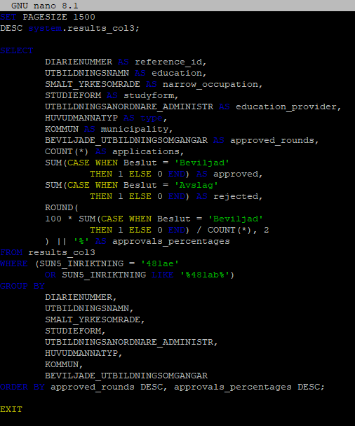
